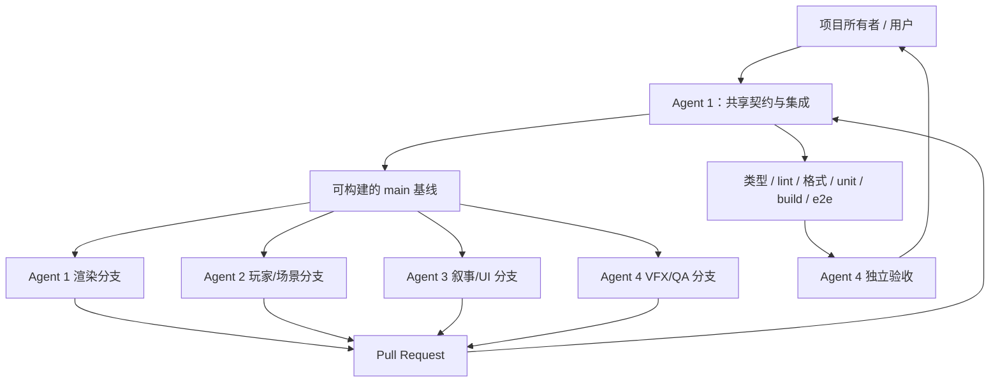

# 四 Agent 分工与协作关系

本项目使用四个模型 Agent 按模块并行开发。模型名称用于记录开发分工，不是项目运行依赖，也不代表模型输出可以绕过人工审查、测试或 PR。

## 1. 当前版本的责任分工

| Agent   | 模型                     | 已交付阶段的主要职责                                         | 集成/验收职责                              |
| ------- | ------------------------ | ------------------------------------------------------------ | ------------------------------------------ |
| Agent 1 | DeepSeek V4.1 Flash-1017 | A0 工程骨架与共享契约；A1 世界染色、水彩材质与远山显色       | 共享文件管理、PR 审查、main 集成与发布协调 |
| Agent 2 | GLM-5.3-flash            | A2 玩家、输入、碰撞和第三人称镜头；A3 地形、植被、溪流与地标 | 修复玩家/场景相关回归                      |
| Agent 3 | Qwen4-Max                | A4 故事状态机、星屑、伙伴、HUD、对话与结局                   | 修复叙事、伙伴和 UI 相关回归               |
| Agent 4 | Hy4                      | A5 花瓣、涟漪与测试准备；A6 集成验收、性能和报告             | 独立 QA、真 GPU 门禁和发布证据             |

## 2. V0.2 规划的临时分工

以下是 `docs/V02_VISUAL_WORKFLOW.md` 中的后续视觉计划，不表示这些改进已经全部交付：

| Agent   | V0.2 计划职责                                        |
| ------- | ---------------------------------------------------- |
| Agent 1 | 染色覆盖、线稿、天空、光照与集成                     |
| Agent 2 | 镜头、原创红斗篷角色和动作                           |
| Agent 3 | 临时接管 `src/world/**` 的小径、植被、树木和溪流视觉 |
| Agent 4 | VFX 层次、视觉截图、测试与性能回归                   |

V0.2 期间 Agent 2 不修改 `world`，Agent 3 不修改叙事；临时所有权只在该轮生效。

## 3. 协作关系



核心原则：**并行开发、串行集成、共享契约单点管理、每个里程碑可回滚。**

## 4. 模块所有权

### 默认所有权

| 路径                                                                  | 默认负责人                             |
| --------------------------------------------------------------------- | -------------------------------------- |
| 根配置、lockfile、`src/main.ts`、`src/core/**`、`src/config/world.ts` | Agent 1                                |
| `src/rendering/**`                                                    | Agent 1                                |
| `src/player/**`                                                       | Agent 2                                |
| `src/world/**`                                                        | Agent 2；V0.2 指定阶段临时转交 Agent 3 |
| `src/narrative/**`、`src/companion/**`、`src/ui/**`                   | Agent 3                                |
| `src/effects/**`、测试与验收报告                                      | Agent 4                                |

其他 Agent 需要修改共享文件时，先提交接口变更建议，由 Agent 1 评估和实施。不得在不同分支各自创建同义坐标、事件或状态真源。

## 5. 分支与 PR 流程

1. 从最新 `origin/main` 创建独立分支或 worktree。
2. 每个分支只承担一个可说明的工作包。
3. 不直接推 `main`，不修改无关文件，不批量格式化其他模块。
4. 提交前执行与改动相匹配的真实检查。
5. PR 关联需求或问题编号，列出文件、测试、风险、性能和回滚方式。
6. Agent 1 逐个集成；每合并一个 PR 都重新运行质量门禁。
7. Agent 4 在集成后的 main 上验收，而不是只验证自己的独立分支。

### 里程碑顺序

```text
M0：工程骨架与共享契约
M1：移动 + 世界染色
M2：完整场景与主路线
M3：故事、伙伴、星屑、结局和重置
M4：VFX、性能与 AC-01～12 验收
```

V0.2 视觉开发同样遵循“先构图和染色，再场景密度，最后 VFX 与验收”的顺序。

## 6. Agent 交付回执

每个 Agent 完成后至少提供：

```text
状态：完成 / 部分完成 / 阻塞
对应需求或 Issue：
修改文件：
实现摘要：
执行过的命令与真实结果：
接口或共享文件变更请求：
性能与资产影响：
已知问题：
PR 链接与建议集成顺序：
```

不得使用“理论上可运行”替代实际测试，不得用静态截图代替可交互功能，也不得为了让测试通过而删除断言或降低验收标准。

## 7. 人工维护责任

- 项目所有者决定范围、发布、许可证和外部资产是否采用。
- Agent 1 的集成结果仍需要人工审查，尤其是共享契约、shader 和状态机。
- Agent 4 的报告需要保留测试环境和提交哈希，不能只保留百分比。
- AI 生成或修改的代码由提交者承担理解、测试和许可证检查责任。
- 发布前应清理过期历史结论，明确哪些文档是当前事实、哪些是历史记录或后续计划。
