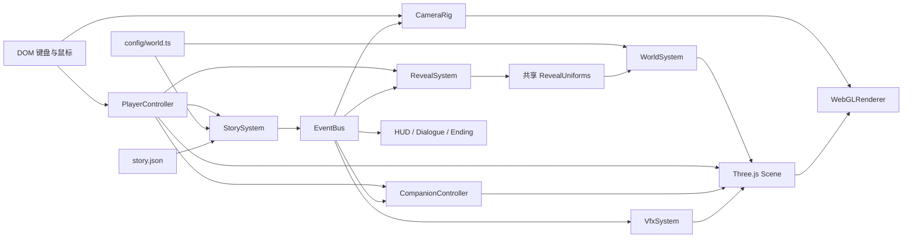
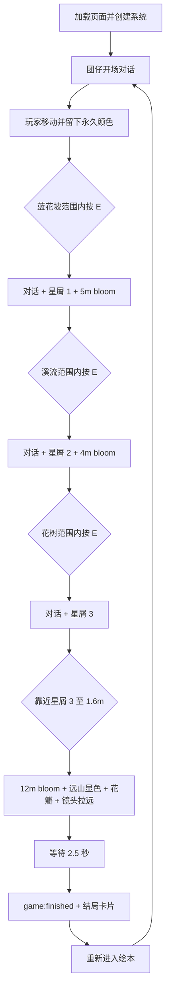
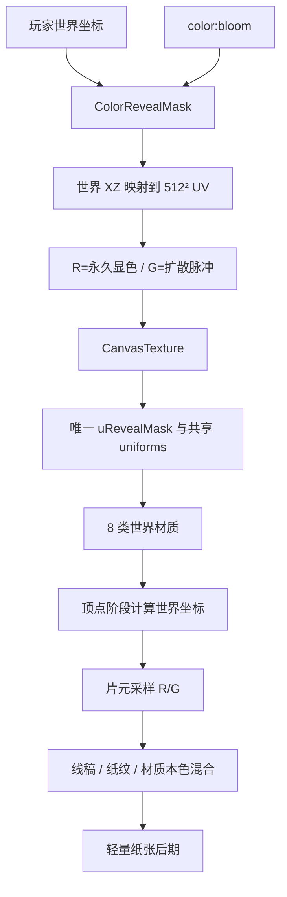

# 架构、业务流程与关键数据流

本文描述当前可运行实现，而不是 V0.2 规划。代码基线为当前 `main`；最终验收数字对应 `src/tests/A6_ACCEPTANCE_REPORT.md` 中注明的提交。

## 1. 技术边界

- 应用形态：独立浏览器 Web 应用，不是 npm 组件库或服务端项目。
- 构建与语言：Vite + TypeScript 严格模式。
- 渲染：Three.js `WebGLRenderer` / WebGL2，Three.js 锁定 `0.187.0`。
- 状态：内存中的运行时状态；没有后端、账号和持久化存档。
- 资产：当前场景、角色、伙伴、VFX 和纹理均为程序化生成；故事文本为本地 JSON。
- 输入：桌面键盘和鼠标。

## 2. 模块关系



### 模块职责

| 模块        | 主要职责                                     | 不应承担               |
| ----------- | -------------------------------------------- | ---------------------- |
| `core`      | 主循环、系统阶段、事件、共享类型、错误和调试 | 具体故事规则或场景建模 |
| `config`    | 世界唯一空间参数、地标与节点顺序             | 另一套重复坐标         |
| `player`    | 输入、移动、碰撞、玩家快照与镜头             | 故事推进或染色实现     |
| `rendering` | 遮罩、材质、后期与结局远山显色               | 决定故事何时完成       |
| `world`     | 程序化场景和材质绑定                         | 自己创建另一张染色遮罩 |
| `narrative` | 状态机、星屑、文本校验和故事事件             | 直接实现镜头或 shader  |
| `companion` | 跟随、引导和回收                             | 替代玩家碰撞或导航系统 |
| `ui`        | 展示状态、收集输入意图和调试入口             | 持有另一份故事真源     |
| `effects`   | 事件驱动 VFX、容量和生命周期                 | 阻塞故事完成事件       |

## 3. 完整用户与业务流程



### 状态机语义

```text
intro
  → flower
  → stream
  → tree（已互动，但尚未完成）
  → 收集 shard-tree
  → finished
  → game:finished
```

- `flower` 和 `stream` 在互动时立即完成。
- `tree` 必须收集本节点生成的星屑后才完成。
- 节点前置条件检查 `completed` 节点，不检查前两枚星屑是否已收集。
- `completed`、`interacted` 和 `collectedShards` 用于幂等和去重。
- 故事文本和规则由 `src/narrative/story.json` 提供，坐标与空间半径来自 `src/config/world.ts`。

## 4. 每帧系统顺序

`Game` 按系统阶段和注册顺序稳定排序，当前实际顺序为：

```text
DOM 事件写入 InputState
  → player
  → companion
  → story
  → ui-hud
  → ui-dialogue
  → ui-ending
  → ui-debug
  → reveal
  → world
  → effects-vfx
  → camera
  → renderer.render
  → FPS / 帧时间统计
```

关键约束：

- 页面隐藏时停止业务更新；恢复时重置时间基准。
- 单帧 delta 有上限，避免恢复页面后角色或动画瞬移。
- `world` 首帧完成材质绑定，之后基本不执行逐帧逻辑。
- 调试 DOM 和遮罩缩略图按间隔刷新，不需要每帧更新。
- 故事和 VFX 通过离散事件协作；逐帧位置通过只读快照读取。

## 5. 世界染色数据流



### 实现要点

- 映射：`u=(x-minX)/width`，`v=(z-minZ)/height`。
- 笔刷按玩家位移补点，bloom 有持续时间和永久结果。
- 遮罩采用脏更新和最高 30Hz 上传，避免每帧无意义重传。
- 世界材质种类为 `terrain`、`grass`、`flower`、`water`、`treeTrunk`、`treeCanopy`、`rock`、`mountain`。
- 玩家、伙伴、星屑和 VFX 不使用这套世界染色材质。
- `WatercolorPass` 只提供统一纸张颗粒和轻微后期，不替代世界遮罩。

### 结局远山显色

花树完成时，`FinaleReveal` 在约 2.6 秒内推进。shader 仅对世界边界外的片元叠加该进度，因此远山可以显色，而不改变界内永久路径或普通节点 bloom。

## 6. 事件流

| 事件                 | 发送方                                  | 当前真实接收方与效果                                     |
| -------------------- | --------------------------------------- | -------------------------------------------------------- |
| `dialogue:requested` | StorySystem                             | DialogueBox 显示文本                                     |
| `color:bloom`        | StorySystem                             | RevealSystem 扩散遮罩；VfxSystem 生成涟漪                |
| `story:completed`    | StorySystem                             | Companion 更新目标；tree 时触发远山显色、花瓣和镜头拉远  |
| `shard:collected`    | StorySystem                             | 当前没有生产模块订阅；HUD 轮询 StorySystem 状态          |
| `game:finished`      | StorySystem                             | EndingOverlay 显示；DialogueBox 关闭；Companion 停止引导 |
| `game:reset`         | EndingOverlay、DebugPanel 或 Game.reset | 各游戏系统执行自己的复位                                 |

EventBus 同步调用监听器；单个监听器异常会被捕获并上报，不阻止其他监听器执行。

## 7. 重置流程

`game:reset` 触发：

- 玩家回出生点，清速度和按键。
- 伙伴回玩家侧后方，恢复初始引导目标。
- 故事回 `intro`，清节点、互动、星屑和结局计时。
- 对话关闭，结局卡片隐藏。
- 染色遮罩、bloom 和远山显色复位。
- 活跃花瓣与涟漪清空。
- 镜头退出结局运镜并恢复默认参数。

重置后的下一帧会重新在出生点落一笔，因此稳定运行后的遮罩覆盖率不是严格零。重置针对游戏流程；调试统计中的累计计数不一定全部归零。

## 8. 测试与性能边界

- 默认 Playwright 使用 SwiftShader，用于功能和集成回归。
- `npm run test:e2e:hw` 使用系统 Chrome 和真 GPU，用于 AC-10 门禁。
- 故事 e2e 主要通过调试按钮完成节点；移动、镜头和主路线另有真实键盘测试，但目前没有一个自动用例完全通过 WASD+E 步行通关全部故事。
- 历史性能报告中的“最低 FPS”是每秒采样最小值，不是 1% low。
- 10 分钟稳定性观测覆盖错误、Draw Calls 和三角面趋势，不等于证明所有 JS/GPU 资源绝对没有泄漏。

详细实测条件与数字以 `src/tests/A6_ACCEPTANCE_REPORT.md` 为准。

## 9. 二次开发入口

| 需求                         | 优先修改位置                                       |
| ---------------------------- | -------------------------------------------------- |
| 修改故事文本、对话和结局延迟 | `src/narrative/story.json`                         |
| 修改节点位置、半径和地图边界 | `src/config/world.ts`，同时检查所有依赖方          |
| 修改笔刷、遮罩或水彩混合     | `src/rendering/`                                   |
| 修改地形、植被或地标         | `src/world/`                                       |
| 修改移动与镜头               | `src/player/`                                      |
| 增加故事驱动 VFX             | `src/effects/`，使用现有事件                       |
| 增加 UI                      | `src/ui/`，从 StorySystem 读取状态，不另建故事真源 |

当前没有稳定 SDK 或插件 API。跨模块接口变更需要同步更新类型、调用方、测试和文档。
